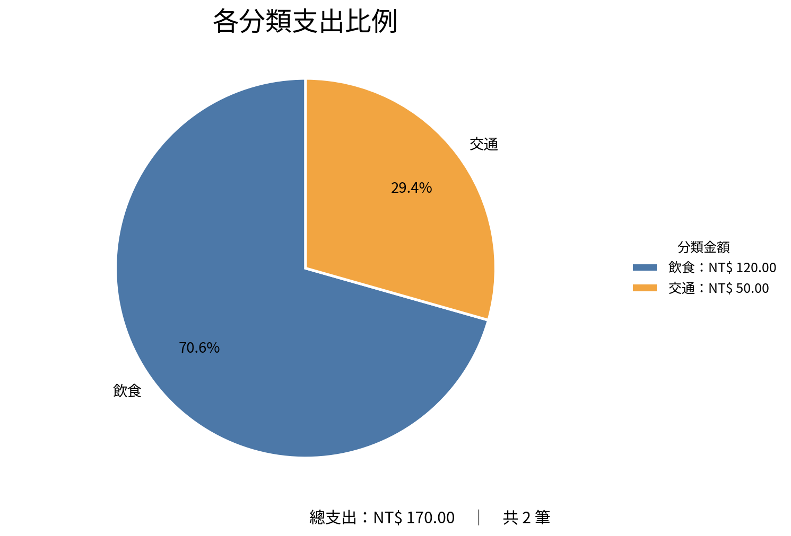

# 簡易記帳與消費分析工具 (Simple Expense Tracker)

這是一個兩人協作開發的 Python 記帳工具，可記錄多筆日常消費並依分類自動產生支出圓餅圖。

## 組員分工
- **1132936林致耀（`feature-input` 分支）**：負責消費輸入介面與 CSV 存檔模組（`input_expense.py`）
- **1132960許峻瑋（`1132960許峻瑋` 分支）**：負責資料讀取與分類圓餅圖視覺化模組（`visualize.py`）

## 環境安裝
1. 下載專案：
```bash
git clone [https://github.com/Jason-la0/expense-tracker.git](https://github.com/Jason-la0/expense-tracker.git)
cd expense-tracker
```
2. 安裝所需套件：
```bash
pip install -r requirements.txt
```

## 執行方式
### 1. 新增記帳紀錄
```bash
python input_expense.py
```
依終端機提示依序輸入日期、金額、分類與選填備註，紀錄會自動儲存至 `expenses.csv`。

### 2. 產生消費分類圓餅圖
```bash
python visualize.py
```
讀取 `expenses.csv` 並依分類繪製圓餅圖，同時匯出圖片檔 `sample_pie_chart.png`。

## 範例輸出結果

