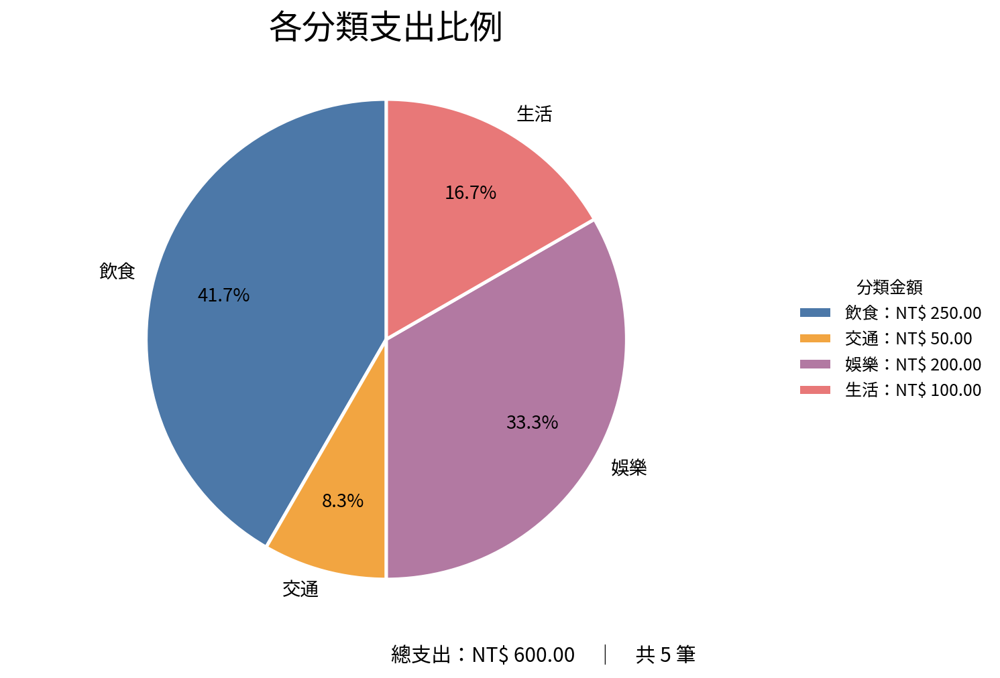

# 成員 B：支出資料視覺化

## 我的工作內容

1. 讀取成員 A 儲存的 CSV；不修改或清空原始記帳資料。
2. 驗證欄位、日期、金額與分類；發現錯誤時顯示原因並停止，避免漏算。
3. 將相同分類的支出金額加總，以金額計算比例。
4. 顯示分類、百分比、各分類金額、總支出與筆數。
5. 儲存圓餅圖，並提供程式執行說明、範例圖與展示。
6. 使用自己的 Git 分支提交開發成果，與 A 共同整合。

## 需要的東西

- Python 3.10 或以上；Windows 安裝時勾選 Add Python to PATH。
- VS Code 或其他文字編輯器（編輯程式用）。
- Python 套件 matplotlib；其依賴由 pip 自動安裝。
- A 產生的 expenses.csv；獨立測試時使用 sample_expenses.csv。
- 中文字型：Windows 通常可使用微軟正黑體；macOS 可使用 PingFang TC；Linux 可使用 Noto Sans CJK。
- Git 與小組 GitHub 儲存庫，用來提交分支及整合程式。
- 錄影軟體（例如已安裝的 OBS），供展示影片使用。

程式也會使用 Python 內建的 csv、pathlib、decimal、datetime、argparse、re、sys，這些不需要另外安裝。金額加總採 Decimal，繪圖時才轉成浮點數。

## 檔案

| 檔案 | 用途 |
| --- | --- |
| visualize.py | B 的完整程式 |
| requirements.txt | 安裝繪圖套件 |
| sample_expenses.csv | 五筆測試資料，不是實際帳本 |
| screenshots/piechart_sample.png | 已用測試資料產生的範例圖 |
| README_B.md | 本操作說明，可整合進小組 README.md |

未包含 A 的輸入程式。合併後請讓 input_expense.py、visualize.py、expenses.csv 位於同一資料夾。既有 requirements.txt 如有內容，加入 matplotlib 那一列即可，不要直接刪掉原內容。

## Windows 執行步驟

1. 解壓縮，進入包含 visualize.py 的資料夾。
2. 在檔案總管的位址列輸入 cmd 並按 Enter，開啟該資料夾的命令提示字元；也可在 VS Code 開啟此資料夾後使用「終端機 → 新增終端機」。
3. 確認 Python：

```bat
python --version
```

若 python 無法使用，但 py 可以使用，以下指令的 python 全部改成 py。

4. 安裝套件：

```bat
python -m pip install -r requirements.txt
```

5. A 尚未完成時，先用測試資料：

```bat
python visualize.py --data sample_expenses.csv --output screenshots/piechart_sample.png
```

終端機會列出分類金額，並開啟圖表。關閉圖表視窗後程式才會結束，這是正常行為。圖片也會儲存，不需要手動截圖。

6. 與 A 整合後，先執行 A 的輸入程式新增資料，再執行：

```bat
python visualize.py
```

預設讀取「visualize.py 所在資料夾」的 expenses.csv，並輸出 screenshots/piechart.png。重複執行會更新同名圖片，不會更動 CSV。請勿為了測試而把 sample_expenses.csv 覆蓋到已有資料的 expenses.csv。

7. 只儲存圖片、不開視窗：

```bat
python visualize.py --data sample_expenses.csv --no-show
```

指定的相對路徑（例如 --data sample_expenses.csv）依終端機目前位置解讀。若從其他資料夾執行，可指定完整資料路徑；預設資料路徑仍固定在程式旁。

## 與 A 的資料格式約定

- 檔名：expenses.csv，編碼 UTF-8 with BOM（Python encoding="utf-8-sig"，newline=""）；一般 UTF-8 也能讀取。
- 第一列依序固定為 date,amount,category,notes，不得重複標題。
- 日期為有效的 YYYY-MM-DD。
- 金額為大於 0 的新臺幣數值，最多兩位小數；A 寫入時統一保留兩位。不得附加元、$、千分位逗號。此程式單筆金額上限為 999999999999.99 元。
- 分類只能是 飲食、交通、購物、娛樂、生活、其他；存文字而非選單編號。
- 備註可以空白，但仍需保留第四欄。使用 csv 模組處理備註內的逗號或換行，不要自行用逗號切字串。
- B 只讀取 CSV；格式不符會停止並提示，不會自動刪除錯誤資料。

```csv
date,amount,category,notes
2026-11-23,100.00,飲食,午餐
2026-11-23,50.00,交通,公車
2026-11-23,150.00,飲食,晚餐
2026-11-23,200.00,娛樂,電影
2026-11-23,100.00,生活,
```

## 正確的測試結果

| 分類 | 金額 | 終端機百分比 |
| --- | ---: | ---: |
| 飲食 | 250.00 | 41.67% |
| 交通 | 50.00 | 8.33% |
| 娛樂 | 200.00 | 33.33% |
| 生活 | 100.00 | 16.67% |
| 總計 | 600.00 | 100% |

共五筆資料；圓餅圖百分比取一位小數，因四捨五入可能不剛好加總成 100%。沒有支出的分類不顯示。



## 程式段落說明

| 段落 | 用途 |
| --- | --- |
| BASE_DIR、FIELDS、CATEGORIES | 設定檔案位置、欄位與固定分類 |
| load_totals() | 逐筆驗證 CSV，以字典儲存各分類總金額，同時計算筆數 |
| configure_font() | 尋找可以顯示中文的字型 |
| draw_chart() | 用 matplotlib 畫圓餅圖、建立圖例、儲存 PNG、顯示視窗 |
| main() | 接收執行參數、列出統計、執行繪圖並處理錯誤 |
| if __name__ == "__main__" | 直接執行此檔案時啟動程式 |

## B 的 Git 工作

以下在已 clone 的小組儲存庫內進行。先確認 A 已完成初始化，並且尚未建立自己的功能分支：

```bat
git switch main
git pull origin main
git switch -c feature-piechart
```

將 visualize.py、requirements.txt、sample_expenses.csv、README_B.md、screenshots/piechart_sample.png 複製到小組專案相應位置。保留既有檔案內容；不要將整份壓縮檔當成原始碼提交。

```bat
git add visualize.py requirements.txt sample_expenses.csv README_B.md screenshots/piechart_sample.png
git commit -m "Add expense category visualization and sample data"
git push -u origin feature-piechart
```

接著依實際修正或整合進度提交有意義的改動，例如處理組員回饋、更新操作說明與整合圖。不要為了增加次數製造沒有內容的提交。若已經建立 feature-piechart，就切換到該分支，不要再次建立。若小組預設分支名稱不是 main，請依實際名稱調整。

完成後由 A 依小組約定使用保留 merge commit 的方式合併兩個功能分支。B 也必須參與整合測試。這個套件不會代替兩位學生建立提交、合併或 Network Graph 證據。

## B 驗收清單

- [ ] 範例資料的飲食加總為 250 元，總額為 600 元。
- [ ] 圓餅圖中文、百分比、分類金額與總額正常。
- [ ] 使用 A 實際產生的 CSV 也能成功繪圖。
- [ ] 找不到檔案、只有標題、錯誤金額或分類時出現明確提示。
- [ ] 執行前後 CSV 內容不變。
- [ ] 圖片可在 screenshots 資料夾找到。
- [ ] 使用自己的 Git 身分提交，並推送 feature-piechart。
- [ ] 將執行說明與範例圖片整合進小組 README.md。

