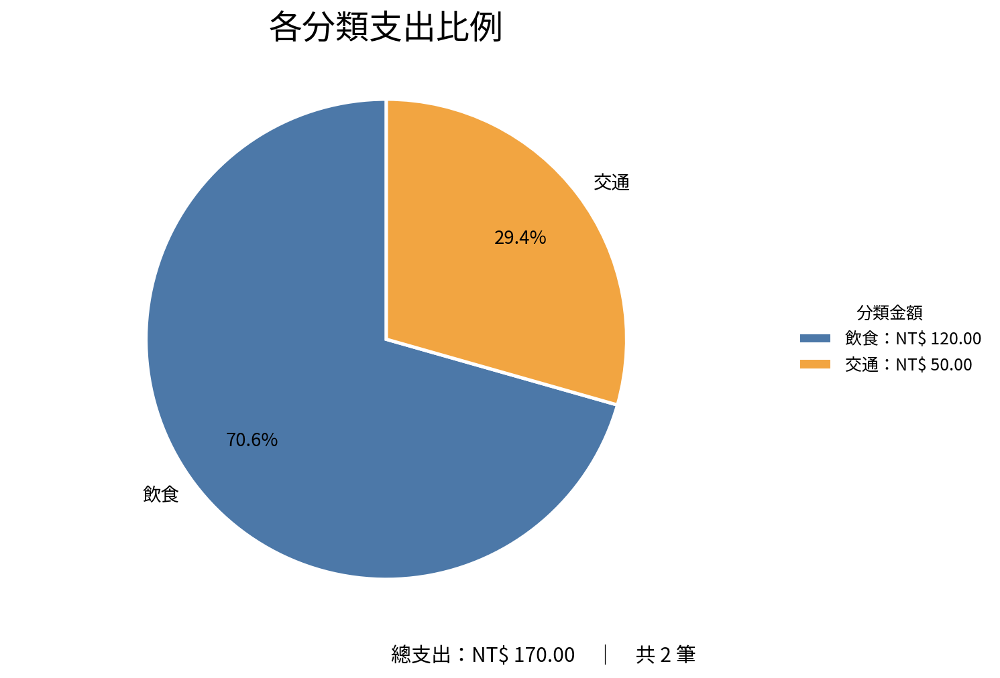

# B 模組：記帳資料視覺化（配合組員 A 的版本）

本版依提供的「協作記帳程式教學」調整介面，讀取 A 的 expenses.csv，依分類加總支出並繪製圓餅圖。

## B 的工作內容

1. 讀取 A 寫入的 CSV，驗證欄位與資料。
2. 將相同分類的金額加總，依金額計算比例，不依資料筆數計算。
3. 產生含中文分類、百分比、金額與總支出的圓餅圖。
4. 將圖表存為 sample_pie_chart.png 並顯示圖表視窗。
5. 維護繪圖執行說明、範例圖，與 A 完成整合測試及展示。

## 這次修改

| 項目 | 舊版 | 本版 |
| --- | --- | --- |
| 備註欄位 | notes | 主要使用 note，也相容舊版 notes |
| 分類 | 固定六種 | 接受任意非空白分類，例如房租、醫療、學費 |
| 金額 | 最多兩位小數 | 接受 A 的正數數值，包括 120.0、多位小數、科學記號；拒絕非有限值 |
| 預設輸出 | screenshots/piechart.png | 程式旁的 sample_pie_chart.png |
| 範例資料 | 五筆、600 元 | 配合教學的兩筆、170 元 |
| Git 分支 | 範例名稱 feature-piechart | 沿用已建立的 1132960許峻瑋，不必重建或改名 |

這些是為了接上 A 程式的共同介面，不是老師另外指定的欄位、檔名或分支名稱。

## 檔案與環境

| 檔案 | 用途 |
| --- | --- |
| visualize.py | 完整 B 程式，含中文註解 |
| requirements.txt | matplotlib，與 A 教學的套件清單一致 |
| sample_expenses.csv | 兩筆範例資料；不覆蓋實際帳本 |
| sample_pie_chart.png | 以兩筆範例產生的圓餅圖 |
| README_B.md | 本文件，可合併進小組 README.md |
| UPDATE_B.txt | 針對你已上傳版本的更新步驟 |

使用 Python 3.10 以上；csv、decimal、datetime、argparse、pathlib、math、sys 都是內建模組，不必另外安裝。Windows 中文顯示優先使用微軟正黑體；macOS 可用 PingFang TC，Linux 可用 Noto Sans CJK。

## 安裝與範例測試（Windows）

1. 解壓縮套件，進入看得到 visualize.py 的那一層。
2. 點檔案總管位址列，輸入 cmd 並按 Enter。
3. 安裝套件：

```bat
py -m pip install -r requirements.txt
```

4. 用新版範例資料執行：

```bat
py visualize.py --data sample_expenses.csv
```

如果電腦用 python 啟動，就把 py 改成 python。終端機所在位置應包含 sample_expenses.csv；自訂相對路徑依終端機目前位置解讀。

正確結果：

| 分類 | 金額 | 終端機比例 | 圖上比例 |
| --- | ---: | ---: | ---: |
| 飲食 | 120.00 | 70.59% | 70.6% |
| 交通 | 50.00 | 29.41% | 29.4% |
| 總計 | 170.00 | 100% | 100% |

共兩筆資料。這次測試總額是 170 元，與先前舊範例的 600 元不同。畫面顯示到兩位小數，統計使用原始數值；極小的金額可能因顯示精度而呈現 0.00。

程式會更新 sample_pie_chart.png，顯示圖表視窗；關閉圖表視窗後程式才結束。



## 與 A 的實際整合

請讓 input_expense.py 與 visualize.py 放在同一個專案資料夾。在該資料夾開啟終端機後執行：

```bat
py input_expense.py
```

按照 A 的程式提示輸入日期、金額、分類、備註；新增完畢後離開。確認 expenses.csv 在這個專案資料夾，再執行：

```bat
py visualize.py
```

A 教學程式使用「終端機目前資料夾」儲存 CSV，B 預設使用「visualize.py 所在資料夾」讀取 CSV。因此，請依上述方式在兩支程式所在的專案資料夾執行，才能接上同一份資料。

B 不會修改 CSV；只會讀取並更新同名圖片。測試範例和實際資料會寫到同一個預設圖片檔，請在要上傳範例圖前確認它呈現的是你想展示的資料。

其他選項：

```bat
py visualize.py --data sample_expenses.csv --output screenshots/piechart.png
py visualize.py --data sample_expenses.csv --no-show
```

--output 可自訂圖片位置，資料夾不存在時自動建立；--no-show 只存圖、不開視窗。舊版的 --data、--output、--no-show 用法仍然可用。

## 與 A 的 CSV 介面

使用 UTF-8 with BOM（Python 的 utf-8-sig），第一列固定如下：

```csv
date,amount,category,note
2026-11-27,120.0,飲食,午餐便當
2026-11-26,50.0,交通,
```

- date：有效日期，使用與 A 相同的 datetime.strptime 格式解析。
- amount：大於 0 的有限數值；可讀取 A 以 float 寫出的 120.0、多位小數及科學記號。加總採 Decimal，避免再引入一般二進位浮點的加總誤差；A 已寫入 CSV 的數值以檔案為準。
- category：自行輸入的非空白分類；同名分類合併，外側空白會去除。
- note：備註可空白，但保留第四欄。讀取使用 csv 模組，支援引號、逗號及合法的欄位內換行。
- 為相容前一版，也可讀取 date,amount,category,notes。新資料請與 A 統一使用 note。
- 欄位順序固定，不可有重複標題、缺少欄位或多餘欄位。

找不到檔案、只有標題、無效日期、空白分類、零或負數、NaN、Infinity 等情況會顯示錯誤原因並停止，不會悄悄略過資料而畫出不完整的總額。

## 程式段落

| 段落 | 功能 |
| --- | --- |
| FIELDS、LEGACY_FIELDS | 定義 A 的新格式與舊版相容格式 |
| load_totals() | 驗證資料，動態建立分類並加總，回傳分類金額與筆數 |
| configure_font() | 尋找可以顯示中文的字型 |
| draw_chart() | 繪製比例、金額圖例與總額，儲存 PNG，可選擇顯示視窗 |
| main() | 解析參數、列出統計、控制流程、顯示錯誤 |

## GitHub 更新與 README

你已在網頁建立 1132960許峻瑋 分支並上傳舊版，因此不必按照教學重新 clone 或另建 feature-piechart。保持同一分支更新程式即可；分支名稱不是作業指定的英文名稱。

先更新 visualize.py，提交說明可填「修正 CSV 備註欄位相容與自訂分類統計」。測試後再更新文件、範例 CSV、圖片及必要的 requirements.txt，提交說明可填「更新與 A 整合的測試資料、圖表與操作說明」。這兩次都代表實際改動；多次有意義的提交有助於呈現開發過程，但原作業沒有硬性規定每人恰好兩次 commit。

將本文件中的安裝、範例測試、實際整合、CSV 介面與圖片引用合併進小組 README.md，保留 A 原本的內容。README.md 必須包含兩支程式的執行方法。不要為了上傳 B 的說明而直接覆蓋整份小組 README。

A 已有 requirements.txt 時，確認其中含 matplotlib 即可。本版也統一為一行 matplotlib，方便兩個分支整合。

請 A 合併時使用你的實際分支名稱，而非教學的範例名稱。若 A 在終端機合併，可以在適當的整合步驟使用：

```bat
git merge --no-ff "origin/1132960許峻瑋" -m "Merge B visualization module"
```

這只是 B 分支的合併指令，仍需 A 先更新遠端資訊、切到正確整合分支，並合併 A 自己的功能分支後推送。兩位成員皆應保留實際貢獻紀錄。

## 最後核對

- [ ] 新範例兩筆資料：飲食 120 元、交通 50 元，總計 170 元。
- [ ] 實際讀取 A 產生的 expenses.csv，分類金額正確。
- [ ] A 自訂房租、醫療等分類時，B 也能顯示。
- [ ] sample_pie_chart.png 已上傳，小組 README 可正常顯示。
- [ ] 兩人的功能分支確實合併，保留 merge commit。
- [ ] 使用原作業要求的 GitHub Insights → Network 截圖；本教學提到的 VS Code 截圖不能自行視為已被老師接受的替代品。
- [ ] 展示 A 新增資料與 B 繪圖的影片連結已準備。

## B 展示講稿

「我負責視覺化模組，會讀取組員 A 儲存的 CSV。欄位統一為 date、amount、category、note，分類可以由使用者自行輸入。程式將相同分類的金額加總，再依金額計算圓餅圖比例。範例包含飲食 120 元與交通 50 元，總額是 170 元，飲食約占 70.6%。圖表會自動存為 sample_pie_chart.png，並顯示各分類金額與總支出。資料格式有錯時，會顯示提示，避免出現漏算的圖表。」
